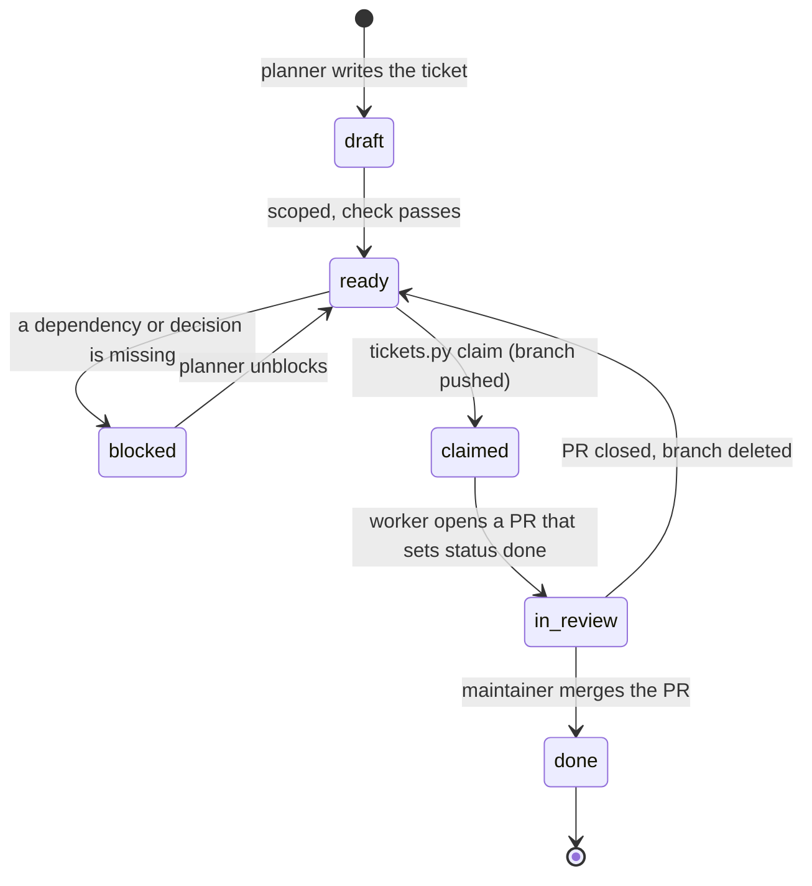

# Tickets

A ticket is a scoped unit of work that a model can finish without design
decisions. The planner model writes tickets. A worker model, often a small
local model, executes `tier: small` tickets and opens a PR. The roles, machines
and the overnight loop are in [`docs/AGENT_HANDOFF.md`](../AGENT_HANDOFF.md).

The ticket file in this directory is the source of truth. Boards in other
tools only mirror it.

## Format

One file per ticket: `docs/tickets/T-NNN-slug.md`. Start from
[`TEMPLATE.md`](TEMPLATE.md).

```yaml
---
id: T-001
title: Prune mock-only tests from core/tests/test_centrifugo.py
status: ready           # draft | ready | blocked | done
tier: small             # small | large
depends_on: []          # ticket IDs
owns:                   # every path/glob the PR may change; nothing else
  - core/tests/test_centrifugo.py
shared: []              # hot files (see below)
journeys: []            # J-NNN
features: []            # F-NNN
branch: agent/T-001-prune-centrifugo-tests
---
## Context
## Change
## Do not
## Verify
## Done when
```

|Key|Type|Rule|
|---|---|---|
|`id`|string|`T-NNN`. Must match the file name prefix. Unique.|
|`title`|string|Imperative summary.|
|`status`|string|`draft`, `ready`, `blocked` or `done`.|
|`tier`|string|`small`: a worker model can do it with no exploration. `large`: planner only.|
|`depends_on`|list|Ticket IDs. Each must exist. No cycles.|
|`owns`|list|Paths, directories (`core/tests/`) or globs (`core/tests/test_*.py`). The PR may change these and nothing else, except the `status` line of its own ticket file.|
|`shared`|list|Hot files this ticket touches. Also list them in `owns`.|
|`journeys`|list|`J-NNN` IDs from `docs/product/journeys/`.|
|`features`|list|`F-NNN` IDs from `docs/product/FEATURES.md`.|
|`branch`|string|Starts with `agent/<id>-`, for example `agent/T-001-prune-centrifugo-tests`.|

All five body sections are required. A ticket with `tier: small` and
`status: ready` also needs a non-empty `owns`, a branch, and at least one
fenced command block under `## Verify`.

## Commands

```bash
uv run python scripts/tickets.py check                # validate every ticket (gate)
uv run python scripts/tickets.py next --tier small    # list claimable tickets
uv run python scripts/tickets.py show T-001           # ticket plus claimability
uv run python scripts/tickets.py claim T-001          # atomic claim
uv run python scripts/tickets.py claim T-001 --dry-run
```

Set `TICKETS_DIR` to point the script at another directory.

`check` exits 1 when a ticket has bad frontmatter, a missing section, an
unknown or cyclic dependency, a duplicate id, or a collision.

`next` lists tickets that are `ready`, have every dependency `done`, have no
`agent/<id>-*` branch on `origin`, and do not overlap a claimed ticket. With no
`origin` remote it reads local branches and says so.

## Status lifecycle

The file holds the planned state. Git holds the in-flight state: a remote
branch `agent/T-NNN-*` means the ticket is claimed.



`claimed` and `in_review` are not values in the file. They are the branch and
the PR.

1. **Claim.** `tickets.py claim T-001` fetches `origin/main` and pushes it to
   `refs/heads/<branch>` with `--force-with-lease=refs/heads/<branch>:`. The
   empty expected value means "the ref must not exist", so the push is atomic:
   when two workers race, one push fails and that worker sees "taken".
2. **PR.** The worker commits on the branch. The same PR changes
   `status: ready` to `status: done` in its own ticket file.
3. **Merge.** Merging the PR lands the code and `status: done` together, so the
   ticket closes with the merge. Delete the branch after the merge.
4. **Abandon.** To release a claim, close the PR and delete the remote branch
   (`git push origin --delete <branch>`).

## Collision rules

Two `ready` tickets with no `depends_on` path between them must not overlap in
`owns`, and must not share a `shared` entry. `check` also compares `owns`
against the other ticket's `shared`.

Entries overlap when they are equal, when one is a directory that contains the
other, or when a glob matches the other entry. The check is conservative: two
globs overlap when one literal prefix starts the other.

To fix a collision, either merge the two tickets, or add a `depends_on` so they
run in order.

`next` also skips a ticket that overlaps a ticket that is claimed and not done.

### Hot files

These files change in many tickets. List them under `shared` (and `owns`)
whenever a ticket touches them.

|File|Rule|
|---|---|
|`<app>/migrations/`|One ticket per app at a time. After a rebase, delete your migration and run `just makemigrations` again. Never renumber by hand.|
|`docs/openapi/openapi.json`|Regenerate with `just openapi`. Never hand-merge it.|
|`uv.lock`|Regenerate with `uv lock`. Never hand-merge it.|
|`CHANGELOG.md`|Append only, under `## [Unreleased]`. Do not edit released sections.|
|`api/urls.py`|Add one `register_controllers` line. Do not reorder.|
|`pyproject.toml`, `api/settings/*`|Small tickets do not change these unless the ticket says so.|

## Mirror a ticket to a board

You can mirror tickets to a board so people can see the queue. The repo file
stays the source of truth: edit the file, then update the card.

- Card title: `T-NNN title`, for example `T-001 Prune mock-only tests from core/tests/test_centrifugo.py`.
- Card body: a link to the file on GitHub, for example
  `https://github.com/<owner>/<repo>/blob/main/docs/tickets/T-001-prune-centrifugo-tests.md`.
  Do not copy the ticket body; it goes stale.

|Board|Create a card|
|---|---|
|Hermes kanban|`hermes kanban create "T-001 Prune mock-only tests" --body "<file URL>" --assignee <profile>` ([docs](https://hermes-agent.nousresearch.com/docs/user-guide/features/kanban))|
|GitHub Issues|`gh issue create --title "T-001 Prune mock-only tests" --body "<file URL>"`|
|Linear, Jira|Create an issue with the same title and body.|

Close the card when the PR merges. Do not track claim state on the card; the
`agent/T-NNN-*` branch is the claim.
